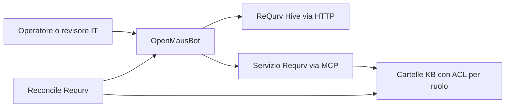

# OpenMausBot per Requrv KB

Studio di fattibilità · 18 novembre 2026

**OpenMausBot è un candidato concreto per la chat degli operatori e del Knowledge Manager. La parità completa richiede un adattatore Requrv per catalogo, aggiornamenti e revisione IT.** Il bot e le quattro skill si installano già su un server OpenMausBot senza desktop. La distribuzione dei file di supporto, le ACL delle cartelle e il ciclo di pubblicazione restano compiti dell'integrazione.

Proverei **OpenMausBot OSS in modalità headless con il driver HTTP compatibile OpenAI e un server MCP Requrv**, mantenendo Hermes come riferimento per le prove di parità. L'adozione ha senso se Hive supporta il flusso di chiamata degli strumenti e se la prova con due ruoli dimostra che questo assetto semplifica l'operatività. Il porting del tema e del layout Hermes è un lavoro separato, utile solo se serve riprodurre quell'esperienza.

## Perimetro e prove

- **Requrv.** Ho usato il checkout corrente, compresi i flussi IT e il Knowledge Manager ancora nel working tree. La baseline include Nextcloud/Drive sincronizzati, Biblioteca-Agenti, approvazioni sulla revisione, versioni personali, aggiornamenti automatici, documenti e LLM-wiki. Ho rieseguito 10 test mirati su revisione IT, installazione del Knowledge Manager e lint con il checkout Hermes locale alla revisione `b200f5bc60e3`: 10 passati. Il riferimento per la parità è il comportamento del plugin in questo checkout. [Funzionalità Requrv](../README.md#cosa-fa)
- **OpenMausBot.** Ho letto documentazione e codice di `main` alla revisione `176f75be4e66` e provato la release pubblica `v0.1.169` (`b832de78c43c`). In un workspace temporaneo su macOS arm64, con Node 26, il server ha risposto alla health check, `team apply --dry-run` ha previsto la creazione di un bot, `team apply` l'ha creato e `team apply --check` ha restituito `No changes`. Sul disco erano presenti i quattro `SKILL.md` originali. Il percorso headless via YAML non ha trasferito `scripts/wiki_lint.py`. La prova ha coperto il provisioning, senza chiamate a Hive o generazione della wiki. [Codice esaminato](https://github.com/milind-soni/OpenMausBot/tree/176f75be4e66bffb50f16e5e7fc4deaa97e70e4b), [release provata](https://github.com/milind-soni/OpenMausBot/releases/tag/v0.1.169), [CLI headless](https://github.com/milind-soni/OpenMausBot/blob/v0.1.169/docs/headless-cli.md#the-team-file)

## Parità funzionale

| Funzione Requrv | Cosa offre OpenMausBot | Lavoro per la parità |
| --- | --- | --- |
| **Chat, bot, istruzioni e skill** | Bot con identità, istruzioni, modello e skill. Chat singole e stanze con più bot. Il provisioning idempotente con `team apply` è verificato per il Knowledge Manager. | Convertire `SOUL.md` e `SKILL.md` mantenendo un legame stabile fra nome Requrv e ID del bot. Distribuire i file di supporto. Il formato di condivisione a cartella li può trasportare con limiti sui file di testo. [CLI](https://github.com/milind-soni/OpenMausBot/blob/v0.1.169/docs/headless-cli.md#the-team-file), [formato di condivisione](https://github.com/milind-soni/OpenMausBot/blob/v0.1.169/docs/team-sharing.md#what-the-folder-holds) |
| **Bot e skill personali** | L’app offre la duplicazione dei bot e skill per bot o importate dalle impostazioni del motore. | La copia personale va scollegata dal reconcile della libreria. Mappare la directory `Operatori/<nome>/skills/` e definire la precedenza in caso di omonimia per il driver HTTP, che usa le skill fornite dall’app. Nel pilot, verificare che aggiornare la versione certificata lasci indipendente il duplicato. [OpenMausBot](https://github.com/milind-soni/OpenMausBot/tree/176f75be4e66bffb50f16e5e7fc4deaa97e70e4b#-manage-bots-like-chats), [skill e import](https://github.com/milind-soni/OpenMausBot/blob/v0.1.169/docs/custom-mcp-servers.md#import-and-choose-tools-per-bot), [duplicazione attuale](../requrv_kb/library.py) |
| **Hive, chiavi e configurazione gestita** | Il driver `openai-compat` accetta URL, chiave e modello, anche con più istanze. Con quel driver OpenMausBot parla via HTTP e non deve lanciare una CLI Claude/Codex per i turni. | Provare l'endpoint effettivo di Hive con streaming, chiamate a tool strutturate e un secondo turno che ne usa l'esito. Mappare le sole impostazioni gestite che servono, mantenendo le credenziali nello store dell'installazione. [Motori personalizzati](https://github.com/milind-soni/OpenMausBot/blob/v0.1.169/docs/custom-engines.md#any-openai-compatible-endpoint-no-process-at-all), [configurazione attuale](../requrv_kb/profile_config.py) |
| **Cartelle sincronizzate e catalogo per area** | Workspace del bot e cartella di lavoro, più strumenti MCP configurabili. Su Team Cloud esiste una cartella condivisa leggibile da tutto il team. | Riutilizzare scoperta delle radici, rilevamento file solo online, unione dei `bots.yaml` e filtro `.autorizzazioni.yaml`. Conservare le ACL cloud e applicare l'identità dell'operatore sul filesystem o nel servizio. `/team-files` è adatta a materiali comuni. [Team files](https://github.com/milind-soni/OpenMausBot/blob/v0.1.169/docs/team-files.md), [MCP personalizzato](https://github.com/milind-soni/OpenMausBot/blob/v0.1.169/docs/custom-mcp-servers.md), [connessione attuale](../requrv_kb/connection.py) |
| **Provisioning, aggiornamento e rollback** | `team apply` permette piano, verifica dello scostamento e aggiornamento. È riapplicabile dopo un'interruzione, ma può applicare solo parte del piano prima di un errore. La libreria gestita aggiorna team già aggiunti, verifica gli hash e gestisce release ritirate. | Conservare il reconcile Requrv per elenco abilitato, installazione automatica, aggiornamenti, report, due snapshot e rollback. Evitare `--prune` e aggiornare solo i campi gestiti. Il catalogo org non installa i pacchetti marcati Required e l'aggiornamento non introduce bot, stanze o routine nuovi nella release. [CLI](https://github.com/milind-soni/OpenMausBot/blob/v0.1.169/docs/headless-cli.md#the-team-file), [libreria org](https://github.com/milind-soni/OpenMausBot/blob/v0.1.169/docs/org-library.md#updates), [reconcile attuale](../requrv_kb/library.py) |
| **SOUL e skill personali, proposte e conflitti** | La libreria org usa hash per preservare la parte modificata dalla persona quando arriva una nuova release. | Requrv ha una semantica precisa: copia della modifica in `proposte/`, ripristino silenzioso quando la base non cambia, scelta keep/take quando cambia. Agganciare questa logica al provisioning e prevedere un percorso esplicito di personalizzazione, o rilevare le modifiche tramite confronto di snapshot se servono gli editor nativi. La tempestività del mirror va dimostrata. [Regole org](https://github.com/milind-soni/OpenMausBot/blob/v0.1.169/docs/org-library.md#updates), [versioni personali](versioni-personali.md) |
| **Autorizzazioni, modifiche gestite e revisione IT** | Approval card, selezione dei tool per bot e MCP. Le possibilità di limitare gli strumenti nativi cambiano tra driver. | Esporre `kb_personal`, `kb_proposals` e `kb_updates` via MCP. L'identità effettiva e il ruolo vanno verificati dal servizio ad ogni chiamata IT. Per pubblicazione o integrazione, l'approvazione deve riferirsi alla diff e alla versione proposte. I permessi effettivi dei file vanno applicati fuori dal prompt. [Approval levels](https://github.com/milind-soni/OpenMausBot/blob/176f75be4e66bffb50f16e5e7fc4deaa97e70e4b/docs/approval-levels.md), [selezione dei tool](https://github.com/milind-soni/OpenMausBot/blob/176f75be4e66bffb50f16e5e7fc4deaa97e70e4b/docs/tool-selection.md), [servizio IT attuale](../requrv_kb/it.py) |
| **Wiki e pubblicazione documentale** | Skill Markdown, tool MCP e routine. Il bot può seguire le stesse procedure con accesso ai file autorizzati. | Riutilizzare schema, provenienza, log, canone e lint. Usare strumenti di lettura e scrittura circoscritti e pubblicare solo dopo anteprima e verifica. Il checkout Requrv contiene istruzioni e lint per questo flusso. Con il driver HTTP, fornire via MCP anche l’estrazione dei formati aziendali effettivi, inclusi DOCX, PDF e XLSX se presenti. La generazione con modello, la pubblicazione e la chiusura delle proposte vanno provate da capo. [Pacchetto Knowledge Manager](../kb-template/Biblioteca-Agenti/knowledge-manager/README.md), [routine](https://github.com/milind-soni/OpenMausBot/blob/176f75be4e66bffb50f16e5e7fc4deaa97e70e4b/docs/routine-schedules.md) |
| **Cattura automatica di conoscenza** | OpenMausBot può estrarre note nella memoria del bot dopo un periodo di inattività o un gruppo di turni. Ha anche memoria condivisa di team con proposte. | È un possibile miglioramento rispetto a un flusso Requrv ancora manuale. La memoria OpenMausBot ha destinazione, visibilità e ciclo di vita propri. Per la KB serve un passaggio controllato che proponga note con provenienza in `Operatori/<nome>/proposte/knowledge/`, con revisione IT prima dell'ingest. [Memoria e cattura](https://github.com/milind-soni/OpenMausBot/blob/v0.1.169/docs/memory.md#memory-upkeep), [limiti attuali Requrv](../README.md#cosa-fa) |
| **Desktop, onboarding e avvio** | Desktop Electron, interfaccia web e CLI. La CLI offre provisioning da YAML e controllo dello scostamento. Le routine headless possono continuare a macchina utente spenta, se il server resta acceso. | Ricreare collegamento, stato KB e «Controlla ora» se necessari. Tema Syne, layout minimal ed estensioni delle impostazioni Hermes richiedono lavoro specifico. Per installazioni locali serve decidere come avviare il reconcile all'avvio e prima del primo uso. [Self-hosting](https://github.com/milind-soni/OpenMausBot/blob/176f75be4e66bffb50f16e5e7fc4deaa97e70e4b/docs/self-hosting.md#what-works-headless-and-what-doesnt), [Desktop Requrv](../README.md#tema-e-layout-hermes-desktop) |

## In che senso può essere più leggero

**Come interfaccia**, l'idea di un elenco di bot e stanze può ridurre i passaggi per l'operatore. **Come installazione**, OpenMausBot headless con driver HTTP elimina Electron dal server e il processo del motore CLI dal percorso del turno. Restano Node, OpenMausBot stesso e il servizio Requrv. Il Dockerfile ufficiale include un browser e librerie native, quindi la scelta headless da sola non determina la dimensione del deployment. [Architettura e avvio](https://github.com/milind-soni/OpenMausBot/blob/176f75be4e66bffb50f16e5e7fc4deaa97e70e4b/docs/self-hosting.md), [Dockerfile](https://github.com/milind-soni/OpenMausBot/blob/176f75be4e66bffb50f16e5e7fc4deaa97e70e4b/Dockerfile)

Il pacchetto macOS arm64 `v0.1.169` pesa **323 MB** come DMG e l'app installata su questa macchina occupa circa **781 MiB** su disco (`du -sk`, 799.984 KiB). La `Hermes.app` presente qui è un installer, quindi il suo bundle è una base inadeguata per confrontare i runtime completi. Mancano misure comparabili su RAM, avvio, latenza e token. Nel pilot misurerei entrambe le configurazioni a parità di modello Hive, macchina, corpus, numero di chat e strumenti esposti. [Asset di release](https://github.com/milind-soni/OpenMausBot/releases/tag/v0.1.169)

## Architettura da provare

1. **Nucleo Requrv in Python.** Riutilizzare catalogo, autorizzazioni, validazione dei pacchetti, snapshot, versioni personali e servizi IT. Le dipendenze da isolare sono i percorsi e le operazioni sui profili, gli hook Hermes, l'iniezione del prompt e la Dashboard. Lo stato e i comandi deterministici oggi disponibili da `hermes kb` e `/kb` devono restare accessibili da CLI e tool, anche senza una schermata dedicata. Il watcher resta un componente applicativo con lock locale, distinto dalle routine lanciate dal modello. Per il pilot può girare vicino alle cartelle sincronizzate, senza introdurre un servizio centrale nuovo. [Punti di integrazione Hermes](../__init__.py), [operazioni sui profili](../requrv_kb/hermes.py), [watchdog attuale](../requrv_kb/watchdog.py)
2. **Provisioning in OpenMausBot.** Generare il manifesto dal catalogo filtrato, applicarlo con la CLI e mantenere il proprio registro di versione. Per il pilot, eseguire il lint lato MCP così lo script ha una versione controllata. Usare un account o un workspace separato per operatore e IT, con accesso ai soli percorsi consentiti, finché il modello di accesso multiutente del deployment scelto non è verificato. Impostare esplicitamente approvazioni e computer nel manifesto. [Team file](https://github.com/milind-soni/OpenMausBot/blob/v0.1.169/docs/headless-cli.md#the-team-file), [regole di accesso al server](https://github.com/milind-soni/OpenMausBot/blob/176f75be4e66bffb50f16e5e7fc4deaa97e70e4b/docs/self-hosting.md)
3. **Wiki con provenienza e accessi.** Partire da materiale sintetico e una wiki IT per la prova. Prima dell'uso aziendale occorre decidere posizione della Wiki, pubblico, autori e permessi di chiusura delle proposte. Una pagina, il suo titolo e la sua scheda fonte devono rispettare la visibilità delle fonti. Conservare anteprima, esito del lint e riferimento al documento in forza prima di marcare una proposta come integrata. [Decisioni aperte](knowledge-manager-skill-research.md#6-cosa-resta-da-decidere), [skill LLM-wiki](../kb-template/Biblioteca-Agenti/knowledge-manager/skills/llm-wiki/SKILL.md)
4. **Edizione e dipendenze.** Il core è Apache 2.0. La cartella `enterprise/` ha una licenza separata per l'uso in produzione delle sue funzionalità. La libreria organizzativa documentata richiede un account organizzazione e un collegamento ad Admin. Licenza, disponibilità e costi vanno confermati se si vuole usare quel servizio o il white-label. L'architettura del pilot usa filesystem, CLI e MCP e può essere valutata senza quei servizi. [Licenza e confine Enterprise](https://github.com/milind-soni/OpenMausBot/blob/v0.1.169/LICENSING.md), [collegamento della libreria ad Admin](https://github.com/milind-soni/OpenMausBot/blob/v0.1.169/docs/org-library.md#how-the-catalog-arrives)

OpenMausBot include anche un driver ACP per `hermes acp`. È una strada per provare l'interfaccia con Hermes come motore. Va verificato che ciascuna istanza punti al profilo corretto e preservi tool e hook, compresi gli eventi di sessione. Mantiene entrambi i runtime, quindi il valore sarebbe ridurre il rischio di transizione e verificare l'esperienza di chat. [Driver Hermes ACP](https://github.com/milind-soni/OpenMausBot/blob/176f75be4e66bffb50f16e5e7fc4deaa97e70e4b/server/drivers/acp/hermes.ts)

## Criteri per decidere dopo il pilot

| Prova | Esito atteso |
| --- | --- |
| **Hive e MCP** | Un turno in streaming usa un tool di lettura; un turno successivo usa il risultato e cita la fonte corretta. La stessa configurazione riparte dopo un riavvio. |
| **Operatore e IT** | Un operatore vede e installa solo i bot abilitati e non può leggere fonti IT o chiamare i tool di revisione. Il revisore vede una proposta, approva la diff corrispondente e lascia una traccia dell'operazione. Provare anche un accesso diretto ai file o al servizio con l'identità operatore, oltre alla visibilità in chat. |
| **Upgrade completo** | Due release dello stesso bot attraversano installazione, aggiornamento, personalizzazione, conflitto keep/take, duplicazione personale e rollback. Un errore a metà si recupera con una nuova esecuzione; chat e memoria restano associate al bot. Un bot rimosso dall'abilitazione viene segnalato secondo il comportamento attuale. |
| **Wiki e documento** | Il Knowledge Manager genera pagine con fonte, hash, indice e log. Il lint passa, rileva una fonte modificata e impedisce la promozione di una bozza con errori. Un aggiornamento documentale approvato lascia documento in forza, precedente in Archivio e registrazione con impronta; la proposta si chiude dopo l'integrazione. |
| **Vantaggio operativo** | Misurare su entrambi i sistemi i passi per collegare la KB e portare un bot al primo uso, il tempo di aggiornamento, RAM a riposo e durante un turno, latenza e token sullo stesso corpus. Un passaggio a OpenMausBot è giustificato quando i flussi critici passano e il team guadagna semplicità operativa o risorse misurabili. |

La prima tranche è un bot IT con quattro skill, due documenti campione e un operatore senza permessi di revisione. Dopo la prova Hive/MCP si può decidere se investire nell'adattatore di distribuzione. L'alternativa a costo più basso è lasciare il ciclo Requrv su Hermes e adottare OpenMausBot per gli scenari in cui stanze, provisioning headless o approvazioni in chat portano un beneficio dimostrato.
